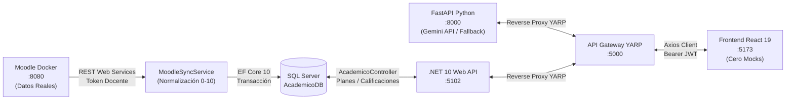

# SISRA — EduMonitor AI | Guía Maestra de Implementación (Sprint 2)
**Universidad Técnica de Ambato (UTA) — FISEI**  
**Carrera de Ingeniería en Software | Metodologías Ágiles | Semestre: Cuarto "B"**  
**Docente Titular:** Ing. Hernán Naranjo  
**Periodo del Sprint 2:** 03 de Noviembre – 14 de Noviembre de 2026  

---

## 1. Objetivo Fundamental del Incremento (Eliminación de Mocks)

> [!IMPORTANT]
> **Consigna Técnica del Docente:** En el Sprint 1 se detectó la presencia de datos estáticos modelados (`EVALUACIONES_BASE_SOF401`, persistencia en `localStorage`). En este Sprint 2 queda **terminantemente prohibido el uso de mocks o datos quemados**. Toda la información debe fluir de extremo a extremo:
> **Moodle Docker (`:8080`) ➔ REST Web Services ➔ Backend .NET 10 (`:5102`) ➔ SQL Server `AcademicoDB` ➔ API Gateway YARP (`:5000`) ➔ Frontend React 19 (`:5173`)**.



---

## 2. ⚠️ Regla de Oro de Base de Datos y Sincronización de Equipo

> [!CAUTION]
> **CERO MODIFICACIONES MANUALES EN SQL SERVER MANAGEMENT STUDIO.**  
> Snaider Toainga ya generó y aplicó en el backend la migración Code-First oficial:  
> `20261108191902_AgregarPlanesRefuerzo` (creación de tablas físicas `PlanesRefuerzo` y `DetallesPlanRefuerzo`).

### Paso obligatorio para Cristian, Estiven y Cesar al iniciar su jornada:
Cada integrante debe actualizar su rama local desde `develop` y sincronizar su base de datos local con un único comando:

```powershell
# 1. Asegurar tener lo último de develop
git checkout develop
git pull origin develop

# 2. Aplicar la migración automáticamente a AcademicoDB local
dotnet ef database update --context AcademicoDbContext --project backend/EduMonitor.Infrastructure --startup-project backend/EduMonitor.Api
```

---

## 3. 📋 Flujo de Trabajo Obligatorio en GitHub Projects e Issues

> [!IMPORTANT]
> **Seguimiento del Tablero Scrum (`SISRA - EduMonitor AI (Scrum Board)`):**  
> El docente evalúa el uso continuo de la herramienta ágil. Cada integrante tiene un Issue formal creado en la columna **`Sprint 2 — Por Hacer`**:
> * **Issue #11:** Cristian Sivinta (`[HU-04A] T-07: Ingesta de datos reales de Moodle Docker y auditoría de sincronización`)
> * **Issue #12:** Estiven Chiluisa (`[HU-04B] T-09: Microservicio FastAPI :8000, Gemini API y Fallback determinista`)
> * **Issue #13:** Cesar Carrasco (`[HU-04A / HU-04B] T-08 y T-10: Desacoplar EVALUACIONES_BASE y vista TutoriaPage.tsx`)
> * **PR #10:** Snaider Toainga (`feat(academico): persistencia relacional de planes de refuerzo y documentacion Sprint 2`)

### Pasos que debe seguir cada integrante al trabajar:
1. **Mover la tarjeta a `En progreso`:**
   En cuanto empieces a codificar tu tarea, entra al tablero `SISRA - EduMonitor AI (Scrum Board)` y arrastra tu Issue desde `Sprint 2 — Por Hacer` hacia **`En progreso`**.
2. **Crear su rama de trabajo desde `develop` actualizado:**
   ```powershell
   git checkout develop
   git pull origin develop
   git checkout -b feature/<nombre-de-tu-tarea>
   ```
3. **Marcar los avances en el Issue:**
   Abre tu Issue en GitHub y ve marcando con un clic los vistos `[x]` en la lista de subtareas conforme las vayas completando.
4. **Vincular el Pull Request con el Tablero e Issue (CRÍTICO):**
   Al terminar tu tarea y abrir el Pull Request hacia `develop`:
   * **En la descripción del PR:** Escribe `Closes #11` (si eres Cristian), `Closes #12` (si eres Estiven) o `Closes #13` (si eres Cesar). Esto cerrará y vinculará automáticamente el Issue cuando se apruebe el PR.
   * **En la barra lateral derecha del PR:**
     * En **Projects**, selecciona **`SISRA - EduMonitor AI (Scrum Board)`**. *(Esto hace que el PR aparezca en el tablero)*.
     * En **Reviewers**, solicita revisión al Scrum Master (`SnaiderToainga`).
5. **Cierre de Tarea:**
   Una vez que el Scrum Master apruebe y fusione el PR en `develop`, la tarjeta se moverá a la columna de **Terminado**.

---

## 4. Reparto de Responsabilidades y Tareas Técnicas Detalladas

---

### 🛡️ INTEGRANTE 1: Snaider Toainga
* **Roles:** Scrum Master | Architecture Lead | Backend Specialist
* **Historias:** HU-04A y HU-04B | **Capacidad Neta:** 24 h

#### Estado de Avance Técnico:
* ✅ **T-10.1 (Modelado Relacional EF Core):** Entidades `PlanRefuerzo.cs` y `DetallePlanRefuerzo.cs` creadas en `EduMonitor.Core.Entities.Academico`.
* ✅ **T-10.2 (Migración Code-First):** Migración aplicada a SQL Server `AcademicoDB` con llaves foráneas e integridad referencial.
* ✅ **T-10.3 (Endpoints de Persistencia):**
  * `POST /api/academico/planes`: Almacena el diagnóstico y actividades remediales por tema.
  * `GET /api/academico/planes/{cursoId}`: Consulta el historial de planes persistidos para evitar re-invocaciones innecesarias a la IA.
* ✅ **T-09.6 (YARP Gateway Route):** Configurado `ai-service-cluster` en `http://localhost:8000`.
* ✅ **Pruebas Automatizadas:** 30/30 pruebas unitarias aprobadas en `EduMonitor.Tests`.

#### Tareas Inmediatas Pendientes:
1. **Pull Request en GitHub:**
   * PR #10 abierto hacia `develop`.
   * Verificar que pase el workflow de CI (`.github/workflows/ci.yml`).
   * Fusionar (Merge) el PR hacia `develop`.
2. **T-08.4 (Autorización Granular JWT):**
   * Verificar que ningún docente pueda consultar o generar planes de asignaturas ajenas (`curso.DocenteId == docente.Id`).
3. **T-08.5 (Gestión del Tablero Scrum):**
   * En el tablero GitHub Projects, mover el PR fusionado a *Done* y supervisar el avance de las tarjetas #11, #12 y #13 en la columna *In Progress*.

---

### 🔌 INTEGRANTE 2: Cristian Sivinta
* **Roles:** Development Team | Backend & LMS Specialist
* **Historia Asignada:** HU-04A (Ingesta de Datos Reales de Moodle) | **Capacidad Neta:** 24 h
* **Issue Asignado:** `#11` | **Rama Git:** `feature/HU-04A-sincronizacion-moodle`

#### Configuración Lista y Credenciales de Moodle Docker:
* **URL:** `http://localhost:8080`
* **Token REST Activo:** `e08c8e99254bf27f9a2a9b6704cc5c4c` (ya inyectado en `backend/EduMonitor.Api/appsettings.json`).
* **ID Docente Moodle:** `3`
* **Cursos Asignados:** Curso `2` (SOF-401 Metodologías Ágiles) y Curso `3` (SOF-402 Estructuras de Datos).

#### Subtareas Asignadas (≤ 4 horas c/u):
* **T-07.1:** Consumo de servicios web REST de Moodle (`core_course_get_courses_by_field`, `gradereport_user_get_grade_items`, `mod_assign_get_submissions`).
* **T-07.2:** Algoritmo de normalización matemática: transformar notas sobre 100 hacia la escala institucional UTA (0.00 a 10.00 con precisión decimal).
* **T-07.3:** Mapeo de llaves foráneas e inserción idempotente en `AcademicoDB` (tablas `Estudiantes`, `Matriculas`, `ItemsEvaluacion`, `Calificaciones`).
* **T-07.4:** Registro de auditoría transaccional en `LogsSincronizacion` (campos `Operacion`, `TotalRegistros`, `Exitoso`, `MensajeError`).
* **T-07.5:** Batería de pruebas de integración con Moodle Docker en `backend/EduMonitor.Tests/MoodleTests.cs`.
* **T-07.6:** Validación de estados de entrega (`Entregado`, `SinEntrega`, `PendienteCalificar`).

#### Verificación Práctica:
Ejecutar una petición HTTP autenticada hacia el Gateway:
```http
POST http://localhost:5000/api/moodle/sync-notas/1
Authorization: Bearer <TOKEN_DOCENTE>
```
Comprobar en SQL Server que la consulta:
```sql
SELECT c.Nota, c.Estado, e.Nombres, e.Apellidos, i.Nombre AS Evaluacion
FROM Calificaciones c
INNER JOIN Estudiantes e ON c.EstudianteId = e.Id
INNER JOIN ItemsEvaluacion i ON c.ItemEvaluacionId = i.Id;
```
devuelva registros con notas reales y **cero registros vacíos o inventados**.

---

### 🤖 INTEGRANTE 3: Estiven Chiluisa
* **Roles:** Product Owner | Backend & Cloud AI Specialist
* **Historia Asignada:** HU-04B (Microservicio de IA & Fallback) | **Capacidad Neta:** 24 h
* **Issue Asignado:** `#12` | **Rama Git:** `feature/HU-04B-microservicio-ia`
* **Directorio de Trabajo:** `ai-service/`

#### Subtareas Asignadas (≤ 4 horas c/u):
* **T-09.1:** Inicializar microservicio con FastAPI y Uvicorn en el puerto `8000` con CORS habilitado.
* **T-09.2:** Diseñar esquemas estrictos de validación con Pydantic v2.
* **T-09.3:** Conectar el cliente oficial de Google Gemini API (`google-genai` con modelo `gemini-2.5-flash` o `gemini-1.5-flash`).
* **T-09.4:** Implementar motor de contingencia local (**Fallback Determinista**) para responder de inmediato ante caídas de red o cuota agotada.
* **T-09.5:** Pruebas automatizadas con PyTest para verificar respuestas JSON válidas.

#### Contrato Oficial de la API de IA:
**Endpoint expuesto:** `POST http://localhost:8000/api/agent/generar-plan`  
*(Accesible desde el Frontend vía Gateway en `http://localhost:5000/api/agent/generar-plan`)*

##### Payload de Entrada (JSON anónimo que envía el Frontend / .NET):
```json
{
  "materia": "Metodologias Agiles",
  "codigo": "SOF-401",
  "parcial": 1,
  "promedioPonderado": 5.10,
  "componentesDeficientes": [
    { "componente": "Tareas", "promedio": 5.00, "ponderacion": 0.30 },
    { "componente": "Examen", "promedio": 4.50, "ponderacion": 0.40 }
  ],
  "temasCriticos": [
    { "id": 104, "nombre": "Historias de Usuario e INVEST", "unidad": "U2" },
    { "id": 105, "nombre": "Estimacion Agil y Planning Poker", "unidad": "U2" }
  ]
}
```

##### Payload de Salida (Estructura JSON estricta esperada):
```json
{
  "nivelRiesgo": "Alto",
  "diagnosticoGeneral": "El estudiante presenta deficiencias criticas en el dimensionamiento de esfuerzo y formulacion de criterios de aceptacion.",
  "esFallback": false,
  "detalles": [
    {
      "temaId": 104,
      "actividadSugerida": "Elaborar matriz de descomposicion de epicas a historias aplicando INVEST",
      "prioridad": "Alta",
      "tiempoEstimadoHoras": 4,
      "recursoRecomendado": "Guia Oficial Scrum UTA - Modulo 2"
    },
    {
      "temaId": 105,
      "actividadSugerida": "Simulacion practica de Planning Poker con baraja Fibonacci",
      "prioridad": "Alta",
      "tiempoEstimadoHoras": 3,
      "recursoRecomendado": "Repositorio Institucional FISEI - Casos de Estudio"
    }
  ]
}
```

---

### 🎨 INTEGRANTE 4: Cesar Carrasco
* **Roles:** Development Team | Frontend & UI/UX Lead
* **Historias Asignadas:** HU-04A y HU-04B | **Capacidad Neta:** 24 h
* **Issue Asignado:** `#13` | **Rama Git:** `feature/HU-04-interfaz-frontend`
* **Directorio de Trabajo:** `frontend/src/`

#### Subtareas Asignadas (≤ 4 horas c/u):

##### Bloque 1: Eliminación de Mocks y Conexión en Vivo (T-08.1 a T-08.3):
1. **Desacoplar Mocks:**
   * En [`EvaluacionesPage.tsx`](file:///C:/Users/User/EduMonitor-AI/frontend/src/pages/EvaluacionesPage.tsx), borrar las constantes en memoria `EVALUACIONES_BASE_SOF401` y `EVALUACIONES_BASE_SOF402`.
   * En `DashboardPage.tsx`, eliminar las lecturas y escrituras hacia `localStorage`.
2. **Carga en Vivo:**
   * Consumir las calificaciones y catálogo desde el backend real mediante:
     ```typescript
     const { data } = await clienteAxios.get(`/api/academico/materias/${cursoId}/evaluaciones`);
     ```
3. **Botón de Refresco Moodle:**
   * Agregar en la barra superior de notas un botón: `[ 🔄 Sincronizar con Moodle ]`.
   * Al hacer clic, invocar `POST /api/moodle/sync-notas/${cursoId}`, mostrando un toast informativo de "Calificaciones actualizadas desde Moodle".
4. **Cálculo Ponderado en Vivo:**
   * Implementar la fórmula institucional 30% Tareas + 30% APE + 40% Examen sobre las notas reales obtenidas.
   * Marcar automáticamente con badge rojo `Riesgo Formativo` a todo estudiante cuyo promedio ponderado sea menor a **7.00**.

##### Bloque 2: Pantalla de Tutoría e Integración IA (T-10.4 a T-10.6):
1. **Crear Vista `TutoriaPage.tsx`:**
   * Registrar la ruta `/tutoria` en `App.tsx`.
   * Agregar el ítem **"Tutoría IA"** en [`Navbar.tsx`](file:///C:/Users/User/EduMonitor-AI/frontend/src/components/Navbar.tsx).
2. **Botón Interactivo y Loader:**
   * Para los estudiantes con promedio < 7.00, incluir el botón **"Generar Plan con IA"**.
   * Al pulsar, mostrar el spinner requerido con el texto:
     > *"Analizando vacíos formativos con IA pedagógica..."*
   * Enviar la petición a `POST /api/agent/generar-plan` vía Gateway.
3. **Renderizado de Acordeones:**
   * Tarjeta con `diagnosticoGeneral` y nivel de riesgo.
   * Si `esFallback === true`, mostrar una alerta preventiva amarilla (*"Plan generado mediante motor de contingencia local"*).
   * Acordeón interactivo desplegable por cada actividad (`actividadSugerida`, badge de `prioridad`, `tiempoEstimadoHoras` y badge de `recursoRecomendado`).
4. **Persistencia Automática:**
   * Una vez generado el plan, guardarlo en SQL Server llamando a:
     ```typescript
     await clienteAxios.post('/api/academico/planes', payloadPlan);
     ```
   * Al recargar la vista, consultar previamente `GET /api/academico/planes/${cursoId}` para mostrar de inmediato los planes ya existentes sin volver a gastar peticiones de IA.

---

## 5. Guía de Arranque del Entorno Completo Local (Día a Día)

Para trabajar de forma sincronizada sin bloqueos, levantar los servicios en este orden:

| Paso | Servicio | Comando / Puerto | Responsable |
| :---: | :--- | :--- | :--- |
| **1** | Moodle Docker | `docker compose up -d` (`:8080`) | Infra / Cristian |
| **2** | SQL Server | Base de datos `AcademicoDB` | SQL Local |
| **3** | Microservicio IA | `cd ai-service; uvicorn main:app --port 8000 --reload` | Estiven |
| **4** | Backend API | `dotnet run --project backend/EduMonitor.Api` (`:5102`) | Backend / Snaider |
| **5** | API Gateway | `dotnet run --project backend/EduMonitor.Gateway` (`:5000`) | Gateway / Snaider |
| **6** | Frontend React | `cd frontend; npm run dev` (`:5173`) | Cesar |

---

## 6. Criterios de Aceptación para la Demo Final del Sprint 2

* [ ] El sistema no contiene ningún array estático o lectura de `localStorage` para notas.
* [ ] Al calificar una tarea en Moodle Docker (`:8080`) y presionar "Sincronizar", la nota se refleja de inmediato en la tabla de React.
* [ ] Los estudiantes con promedio ponderado < 7.00 muestran la opción de diagnóstico asistido por IA.
* [ ] Al presionar "Generar Plan con IA", se despliega el spinner institucional y se renderizan los acordeones pedagógicos.
* [ ] Si se apaga el microservicio de IA o se desconecta internet, el sistema no se rompe; activa el modo fallback preventivo.
* [ ] Al reiniciar la página web o cerrar sesión, los planes de refuerzo persisten intactos desde la base de datos `AcademicoDB`.
* [ ] Todos los Pull Requests cuentan con la vinculación formal en el tablero Scrum, revisión de código y pipeline CI en verde (`✔ ci.yml`).
