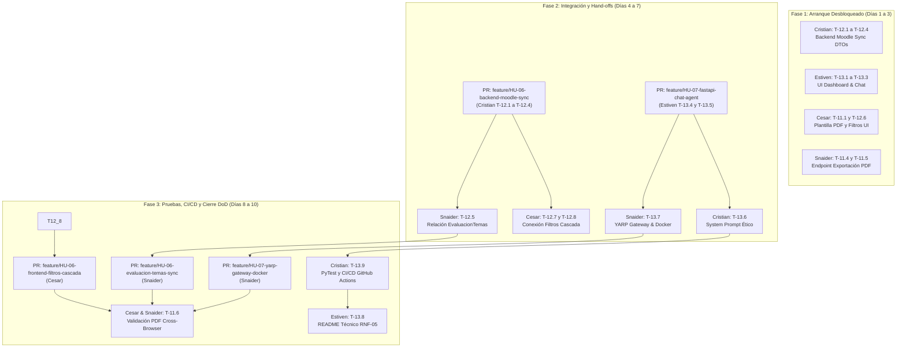

# SISRA — EduMonitor AI | Guía de Trabajo, Issues y Flujo Git (Sprint 3)
**Universidad Técnica de Ambato (UTA) — FISEI**  
**Carrera de Ingeniería en Software | Metodologías Ágiles | Semestre: Cuarto "B"**  
**Docente Titular:** Ing. Hernán Naranjo  
**Período del Sprint 3:** 13 de Noviembre – 27 de Noviembre de 2026  
**Velocidad Comprometida:** 13 Story Points (96 horas netas de ingeniería)  

---

## 1. Política de Trabajo: Desarrollo Incremental (Prohibido el "Big-Bang PR")

> [!IMPORTANT]
> **Regla de Integración Continua:** Bajo el marco de trabajo Scrum y las directrices de ingeniería de software, **queda terminantemente prohibido cerrar todo el Sprint en un único Pull Request masivo al final**.
> * Cada funcionalidad o paquete de tareas debe desarrollarse en su propia rama de corta duración (`feature/...`), validarse localmente y cerrarse mediante un **Pull Request (PR) enfocado** hacia `develop`.
> * Esto evita conflictos de fusión (*merge conflicts*), permite revisiones de código ágiles entre pares y asegura que la rama `develop` siempre tenga software potencialmente desplegable en estado verde.



---

## 2. Matriz de Secuencia: ¿Quién empieza y quién debe esperar?

Para garantizar que nadie tenga tiempos muertos y que no existan bloqueos entre integrantes:

| Integrante | Tareas de Arranque (Día 1 - Inmediato) | ¿Depende de alguien para iniciar? | Tareas posteriores que requieren esperar | ¿A quién desbloquea con su entrega? |
| :--- | :--- | :---: | :--- | :--- |
| **Cristian Sivinta** *(Backend LMS)* | **T-12.1 a T-12.4** (DTOs, MoodleService y MoodleSyncService) | **Nadie (Arranca de inmediato)** | **T-13.6 y T-13.9** (debe esperar que Estiven termine T-13.4/5 en FastAPI para hacer el System Prompt y PyTest/CI). | Desbloquea a **Snaider** (T-12.5) y a **Cesar** (T-12.7 datos de Moodle). |
| **Estiven Chiluisa** *(IA & Data Lead)* | **T-13.1 y T-13.2** (Gráfico de barras) y **T-13.3** (UI Chat) | **Nadie (Arranca de inmediato)** | Avanza a **T-13.4 y T-13.5** (FastAPI) sin bloqueos; en Fase 3 elabora **T-13.8** (README). | Desbloquea a **Cristian** (T-13.6) y a **Snaider** (T-13.7). |
| **Cesar Carrasco** *(Frontend Lead)* | **T-11.1** (Plantilla jsPDF UTA) y **T-12.6** (Componente visual de filtros) | **Nadie (Arranca de inmediato)** | **T-12.7 y T-12.8** (espera que Cristian termine T-12.4 para consumir temas reales de Moodle). | Desbloquea a **Snaider** (para T-11.6 pruebas de PDF). |
| **Snaider Toainga** *(Full Stack / SM)* | **T-11.4 y T-11.5** (Endpoint de exportación y firmas PDF) | **Nadie (Arranca de inmediato)** | **T-12.5** (espera a Cristian T-12.4) y **T-13.7** (espera a Estiven T-13.4 para enrutar en YARP). | Cierra la integración general, relaciones curriculares y xUnit. |

---

## 3. Protocolo de Ramas Git y Pull Requests

Cada desarrollador trabajará con ramas temáticas cortas vinculadas a su Issue de GitHub:

1. **Creación de la rama desde develop actualizado:**
   ```bash
   git checkout develop
   git pull origin develop
   git checkout -b feature/HU-XX-nombre-tarea
   ```
2. **Convención de Commits (Conventional Commits):**
   * Nuevas funciones: `feat(moodle): implementar extraccion de secciones core_course_get_contents`
   * Correcciones: `fix(sync): eliminar timeout y optimizar llamadas a mod_assign`
   * Pruebas automatizadas: `test(xunit): agregar pruebas unitarias de persistencia curricular`
   * Documentación: `docs(readme): agregar manual de instalacion y ejecucion RNF-05`
3. **Apertura del Pull Request:**
   * Título claro: `feat(modulo): descripción concisa de las tareas incluidas`.
   * En la descripción incluir: `Closes #IssueNumber` para vincular y cerrar automáticamente el Issue al fusionar.
   * Solicitar al menos 1 aprobación (Code Review) de otro miembro antes del merge.

---

## 4. Fichas de GitHub Issues para Copiar y Pegar

Crea estas 4 Issues en **GitHub $\rightarrow$ Issues $\rightarrow$ New Issue**:

---

### ISSUE: Cristian Sivinta (Backend LMS Specialist)
* **Título:** `[Sprint 3] HU-06/HU-07: Extracción Curricular Dinámica Moodle y Calidad CI/CD - @CristianSivinta`
* **Labels:** `backend`, `moodle`, `testing`, `sprint-3`
* **Asignado a:** Cristian Sivinta
* **Pull Requests planificados (Formato institucional del repositorio):**
  * **PR A:** Rama `feature/HU-06-backend-moodle-sync`  
    *Título sugerido:* `feat(moodle): T-12.1 a T-12.4 sincronización dinámica Moodle, DTOs y fotos de perfil`
  * **PR B:** Rama `feature/HU-07-system-prompt-ci`  
    *Título sugerido:* `feat(ci-ia): T-13.6 y T-13.9 system prompt ético RNF-08 y pipeline CI/CD con PyTest`

#### Contenido del Issue:
```markdown
### Responsable: Cristian Sivinta (24 horas netas / 6 tareas)
**Historias asociadas:** HU-06 (Desglose Curricular Moodle) y HU-07 (Dashboard & IA)

#### Descripción
Implementar la extracción dinámica de la estructura curricular de Moodle (secciones, unidades, temas y fotos de perfil de estudiantes) eliminando timeouts y datos quemados en el backend, y asegurar la calidad del microservicio de IA con directrices éticas y pipeline de CI/CD.

#### Plan de Tareas Técnicas
- [ ] **T-12.1** (4 h) Validar función `core_course_get_contents` en el servicio externo de Moodle. *(Día 1 - Inmediato)*
- [ ] **T-12.2** (4 h) Definir DTOs de secciones, módulos y fotos de perfil en `EduMonitor.Core`. *(Día 1-2)*
- [ ] **T-12.3** (4 h) Implementar método `ObtenerContenidoCurso` en `MoodleService.cs`. *(Día 2-3)*
- [ ] **T-12.4** (4 h) Refactorizar `MoodleSyncService.cs` para sincronización atómica sin timeouts de entrega. *(Día 3-4)*
- [ ] **T-13.6** (4 h) Configurar System Prompt con directrices éticas de incertidumbre pedagógica (RNF-08). *(Día 6 - Espera a Estiven T-13.5)*
- [ ] **T-13.9** (4 h) Automatizar pruebas PyTest y validar ejecución en verde de GitHub Actions. *(Día 7-8)*

#### Dependencias y Entregas
- **Bloquea a:** Snaider Toainga (T-12.5) y Cesar Carrasco (T-12.7).
- **Bloqueado por:** Estiven Chiluisa (requiere T-13.4/5 para iniciar T-13.6).
- **Estrategia de Pull Requests hacia `develop`:**
  1. Abrir PR de `feature/HU-06-backend-moodle-sync` (`feat(moodle): T-12.1 a T-12.4 sincronización dinámica...`) al terminar T-12.4 para desbloquear inmediatamente el trabajo de Snaider y Cesar.
  2. Abrir PR de `feature/HU-07-system-prompt-ci` (`feat(ci-ia): T-13.6 y T-13.9 system prompt ético...`) al terminar T-13.9 con la validación de CI/CD.

#### Criterios de Aceptación Verificables
- CA-06.1: Ingesta de unidades temáticas reales desde Moodle sin datos estáticos.
- CA-06.3: Extracción de URLs de avatares/fotografías oficiales de los estudiantes.
- CA-07.4: Advertencias de carácter orientativo en las respuestas del asistente de IA.
```

---

### ISSUE: Cesar Carrasco (Frontend Lead)
* **Título:** `[Sprint 3] HU-06/HU-05: Filtros en Cascada, Avatares y Plantilla Oficial de Informes PDF - @CesarCarrasco`
* **Labels:** `frontend`, `ui/ux`, `jspdf`, `sprint-3`
* **Asignado a:** Cesar Carrasco
* **Pull Requests planificados (Formato institucional del repositorio):**
  * **PR A:** Rama `feature/HU-05-frontend-plantilla-pdf`  
    *Título sugerido:* `feat(frontend): T-11.1 y T-12.6 plantilla base PDF institucional y componente visual de filtros`
  * **PR B:** Rama `feature/HU-06-frontend-filtros-cascada`  
    *Título sugerido:* `feat(frontend): T-12.7 a T-12.8 y T-11.2 a T-11.3 filtros en cascada y exportación de reportes PDF`

#### Contenido del Issue:
```markdown
### Responsable: Cesar Carrasco (24 horas netas / 6 tareas)
**Historias asociadas:** HU-06 (Filtros en Cascada) y HU-05 (Informes en PDF)

#### Descripción
Construir en React el sistema interactivo de filtros combinados en cascada por Parcial, Unidad, Tema y Actividad con renderizado de fotos/avatares de estudiantes, y diseñar la plantilla institucional en PDF con membrete oficial de la FISEI - UTA.

#### Plan de Tareas Técnicas
- [ ] **T-11.1** (4 h) Diseñar plantilla membretada UTA / FISEI con `jsPDF` y estilos formales. *(Día 1 - Inmediato)*
- [ ] **T-12.6** (4 h) Construir componente `FiltrosCascada.tsx` y visualización de avatares en React. *(Día 2-3 - Inmediato)*
- [ ] **T-12.7** (4 h) Implementar selector y filtrado por Actividad específica en la tabla de notas. *(Día 4 - Espera a Cristian T-12.4)*
- [ ] **T-12.8** (4 h) Actualizar cálculo dinámico de notas y promedios según filtros aplicados. *(Día 5)*
- [ ] **T-11.2** (4 h) Mapear notas 30/30/40 y diagnósticos cualitativos a la tabla del reporte individual PDF. *(Día 6)*
- [ ] **T-11.3** (4 h) Implementar exportación de matriz consolidada de curso con estados de riesgo. *(Día 7)*

#### Dependencias y Entregas
- **Bloquea a:** Snaider Toainga (T-11.6 para validación de descarga cruzada en navegadores).
- **Bloqueado por:** Cristian Sivinta (requiere T-12.4 para poblar los selectores con datos reales de Moodle).
- **Estrategia de Pull Requests hacia `develop`:**
  1. Abrir PR de `feature/HU-05-frontend-plantilla-pdf` (`feat(frontend): T-11.1 y T-12.6 plantilla base PDF...`) con la estructura visual de filtros y plantilla PDF.
  2. Abrir PR de `feature/HU-06-frontend-filtros-cascada` (`feat(frontend): T-12.7 a T-12.8 y T-11.2 a T-11.3...`) con la integración de datos dinámicos y reportes consolidados.

#### Criterios de Aceptación Verificables
- CA-06.4: Filtros en cascada fluidos: Parcial -> Unidad -> Tema -> Actividad.
- CA-06.5: Selector de tarea específica que aísla las notas de dicha evaluación.
- CA-05.1: Descarga de documento PDF formal con membrete y datos de cátedra.
```

---

### ISSUE: Estiven Chiluisa (Product Owner / AI & Data Lead)
* **Título:** `[Sprint 3] HU-07: Gráficos de Rendimiento en Dashboard, Microservicio Chat IA y Manual Técnico - @EstivenChiluisa`
* **Labels:** `ai-service`, `fastapi`, `frontend`, `documentation`, `sprint-3`
* **Asignado a:** Estiven Chiluisa
* **Pull Requests planificados (Formato institucional del repositorio):**
  * **PR A:** Rama `feature/HU-07-dashboard-barchart`  
    *Título sugerido:* `feat(dashboard): T-13.1 a T-13.3 gráfico de barras de rendimiento y panel de chat`
  * **PR B:** Rama `feature/HU-07-fastapi-chat-agent`  
    *Título sugerido:* `feat(ai-service): T-13.4 y T-13.5 microservicio FastAPI con chat conversacional y tools`
  * **PR C:** Rama `docs/HU-07-readme-tecnico-rnf05`  
    *Título sugerido:* `docs(readme): T-13.8 manual técnico de instalación, variables de entorno y ejecución RNF-05`

#### Contenido del Issue:
```markdown
### Responsable: Estiven Chiluisa (24 horas netas / 6 tareas)
**Historias asociadas:** HU-07 (Dashboard y Asistente IA)

#### Descripción
Implementar el gráfico interactivo de barras clasificado en 4 rangos de rendimiento académico en el Dashboard, construir el endpoint de chat conversacional en FastAPI con soporte determinista a nivel general de curso y por estudiante, y redactar el manual técnico de ejecución (RNF-05).

#### Plan de Tareas Técnicas
- [ ] **T-13.1** (4 h) Crear componente visual `RendimientoBarChart.tsx` con estilos institucionales. *(Día 1 - Inmediato)*
- [ ] **T-13.2** (4 h) Conectar los 4 rangos de notas (Crítico, Riesgo, Regular, Sobresaliente) al Dashboard. *(Día 2)*
- [ ] **T-13.3** (4 h) Diseñar panel flotante de Chat con selector de contexto (Curso / Estudiante). *(Día 3)*
- [ ] **T-13.4** (4 h) Desarrollar endpoint `/api/agent/chat` en FastAPI con esquemas Pydantic. *(Día 4-5)*
- [ ] **T-13.5** (4 h) Implementar Tools deterministas para responder métricas de curso y alumno. *(Día 5-6)*
- [ ] **T-13.8** (4 h) Redactar `README.md` técnico con variables de entorno, puertos y arranque (RNF-05). *(Día 7-8)*

#### Dependencias y Entregas
- **Bloquea a:** Cristian Sivinta (T-13.6 Prompt sobre FastAPI) y Snaider Toainga (T-13.7 Enrutamiento en Gateway YARP).
- **Bloqueado por:** Ninguna dependencia de inicio.
- **Estrategia de Pull Requests hacia `develop`:**
  1. Abrir PR de `feature/HU-07-dashboard-barchart` (`feat(dashboard): T-13.1 a T-13.3...`) con el Dashboard y gráfico de barras.
  2. Abrir PR de `feature/HU-07-fastapi-chat-agent` (`feat(ai-service): T-13.4 y T-13.5...`) con el backend de FastAPI y Tools para desbloquear a Cristian y Snaider.
  3. Abrir PR de `docs/HU-07-readme-tecnico-rnf05` (`docs(readme): T-13.8...`) con la documentación técnica final.

#### Criterios de Aceptación Verificables
- CA-07.1: Gráfico interactivo con desglose de porcentajes en los 4 rangos de rendimiento.
- CA-07.2: Chat IA capaz de resumir el estado global y debilidades del curso.
- CA-07.3: Chat IA capaz de diagnosticar y sugerir refuerzo por estudiante específico.
```

---

### ISSUE: Snaider Toainga (Scrum Master / Full Stack Dev)
* **Título:** `[Sprint 3] HU-05/HU-06/HU-07: Pasarela YARP, Relaciones Curriculares, API de Exportación y Tests - @SnaiderToainga`
* **Labels:** `backend`, `gateway`, `docker`, `tests`, `sprint-3`
* **Asignado a:** Snaider Toainga
* **Pull Requests planificados (Formato institucional del repositorio):**
  * **PR A:** Rama `feature/HU-05-backend-export-pdf`  
    *Título sugerido:* `feat(backend): T-11.4 y T-11.5 endpoint de reporte consolidado y bloque de firma docente`
  * **PR B:** Rama `feature/HU-06-evaluacion-temas-sync`  
    *Título sugerido:* `feat(academico): T-12.5 vinculación automática de evaluaciones con temas curriculares`
  * **PR C:** Rama `feature/HU-07-yarp-gateway-docker`  
    *Título sugerido:* `feat(gateway-docker): T-13.7 docker-compose unificado y enrutamiento YARP con JWT`
  * **PR D:** Rama `test/sprint-3-xunit-integration`  
    *Título sugerido:* `test(qa): T-12.9 y T-11.6 pruebas unitarias xUnit de consistencia y validación PDF cross-browser`

#### Contenido del Issue:
```markdown
### Responsable: Snaider Toainga (24 horas netas / 6 tareas)
**Historias asociadas:** HU-05 (PDFs), HU-06 (Relaciones Curriculares) y HU-07 (YARP Gateway & Docker)

#### Descripción
Configurar el endpoint de agregación para reportes PDF, vincular automáticamente evaluaciones con temas curriculares, orquestar el microservicio de IA en Docker y YARP Gateway bajo JWT, y garantizar la cobertura de pruebas unitarias xUnit.

#### Plan de Tareas Técnicas
- [ ] **T-11.4** (4 h) Crear endpoint de consulta agregada para exportación en `AcademicoController`. *(Día 1 - Inmediato)*
- [ ] **T-11.5** (4 h) Agregar pie de página formal, numeración "Página X de Y" y recuadro de firma docente. *(Día 2)*
- [ ] **T-12.5** (4 h) Vincular automáticamente evaluaciones con temas de sección en `EvaluacionTemas`. *(Día 4 - Espera a Cristian T-12.4)*
- [ ] **T-13.7** (4 h) Unificar `docker-compose.yml` y enrutar `/api/agent/chat` en YARP con JWT. *(Día 5-6 - Espera a Estiven T-13.4)*
- [ ] **T-12.9** (4 h) Escribir pruebas unitarias xUnit de extracción curricular y consistencia relacional. *(Día 7)*
- [ ] **T-11.6** (4 h) Pruebas de compatibilidad y renderizado de descarga PDF en Chrome y Firefox. *(Día 8 - Con Cesar)*

#### Dependencias y Entregas
- **Bloqueado por:** Cristian Sivinta (T-12.4 para iniciar T-12.5) y Estiven Chiluisa (T-13.4 para enrutar T-13.7).
- **Bloquea a:** Cierre del Sprint Backlog y validación final de la Definition of Done (DoD).
- **Estrategia de Pull Requests hacia `develop`:**
  1. Abrir PR de `feature/HU-05-backend-export-pdf` (`feat(backend): T-11.4 y T-11.5...`) con el backend de soporte para PDF.
  2. Abrir PR de `feature/HU-06-evaluacion-temas-sync` (`feat(academico): T-12.5...`) con el enlace de temas y evaluaciones.
  3. Abrir PR de `feature/HU-07-yarp-gateway-docker` (`feat(gateway-docker): T-13.7...`) con la pasarela YARP y Docker Compose.
  4. Abrir PR de `test/sprint-3-xunit-integration` (`test(qa): T-12.9 y T-11.6...`) con las pruebas automatizadas xUnit.

#### Criterios de Aceptación Verificables
- CA-05.4: Paginación limpia sin textos solapados y recuadro oficial de firma docente.
- CA-06.2: Mapeo consistente de cada evaluación con su unidad y tema curricular.
- CA-07.5: Protección de endpoints del agente con JWT y validación de roles en Gateway.
```

---

## 5. Definición de Terminado (DoD) Obligatoria para cada PR

Para que un Pull Request pueda fusionarse a `develop`, debe cumplir con la siguiente lista de verificación:

1. **Compilación Limpia:** Cero errores y cero advertencias de compilación en .NET 10, TypeScript y Python.
2. **Pruebas Automatizadas:** Todas las pruebas unitarias existentes (`xUnit` y `PyTest`) se ejecutan y finalizan con éxito.
3. **No romper ramas ajenas:** La rama debe haberse actualizado previamente contra `develop` antes de abrir el PR (`git merge develop` o `git rebase develop`).
4. **Cero Mocks:** No reintroducir variables locales ni listas fijas en el código.
5. **Aprobación de Código:** Al menos un desarrollador del equipo debe revisar y aprobar los cambios en GitHub.
